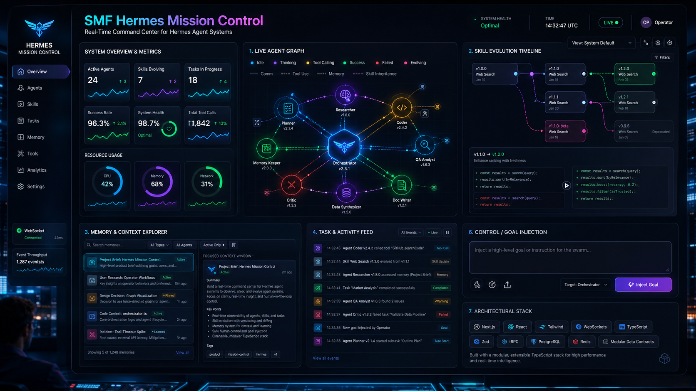
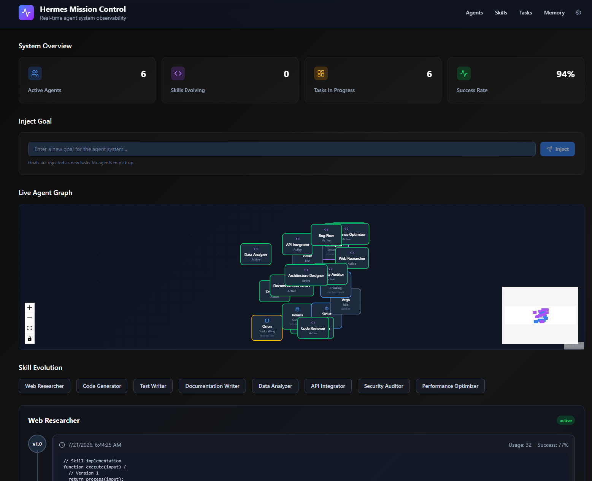

# Hermes Mission Control

<div align="center">
  
</div>

> Real-time visual command center for Hermes agent systems.

Hermes Mission Control is an open-source observability dashboard that lets you
see, understand, and gently steer your Hermes agent swarm in real time. Watch
agents think, communicate, create skills, and execute tasks as a living system.

## Features

### Live Agent Graph
Interactive force-directed graph showing active agents, skills, and their
relationships. Real-time status indicators and click-to-inspect details.

### Skill Evolution Timeline
Visual history of how skills are created, improved, branched, or deprecated.
Side-by-side diffs of skill code versions.

### Memory & Context Explorer
Searchable, filterable view of agent memory. Visual indication of what memories
are currently being attended to.

### Task & Activity Feed
Real-time stream of high-level events. Filterable and searchable. Ability to
inject new goals or instructions from the UI.

### System Overview & Metrics
Clean dashboard cards showing active agents, skills under evolution, tasks in
progress, success rates, and more.

## Screenshot



## Quick Start

```bash
# Clone the repository
git clone https://github.com/smfworks/hermes-mission-control.git
cd hermes-mission-control

# Install dependencies
npm install

# Start the development server
npm run dev

# Open http://localhost:3000
```

## Project Structure

```
src/
├── app/
│   ├── api/              # REST API routes
│   ├── agents/           # Agent list view
│   ├── skills/           # Skill list view
│   ├── tasks/            # Task list view
│   ├── memory/           # Memory explorer
│   ├── layout.tsx        # Root layout
│   └── page.tsx          # Dashboard home
├── lib/
│   ├── types.ts          # Data models
│   ├── mock-data.ts      # Mock data generator
│   └── utils.ts          # Utilities
```

## Architecture

See [ARCHITECTURE.md](ARCHITECTURE.md) for detailed architecture documentation.

## Roadmap

- **Phase 1** ✅ — Foundation & Data Model
- **Phase 2** — Core Visualizations (Agent Graph, Skill Timeline)
- **Phase 3** — Live Data & Control (Activity Feed, Goal Injection, Memory Explorer)
- **Phase 4** — Polish, Metrics & Demo Readiness

## License

MIT License — see [LICENSE](LICENSE) for details.

## Acknowledgments

- Built with [Next.js](https://nextjs.org/) and [Turbopack](https://turbo.build/pack)
- Icons from [Lucide React](https://lucide.dev/)
- Part of the [Hermes Agent](https://github.com/NousResearch/Hermes) ecosystem
